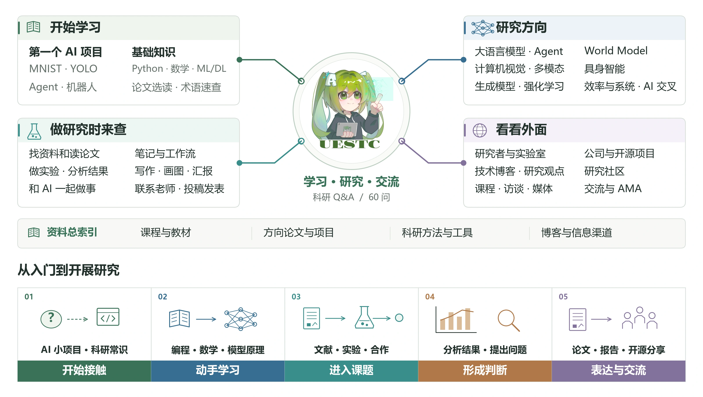

# Bofan Zhu — Personal Homepage

Personal academic homepage for **Bofan Zhu (Hikaru)**, a student researcher exploring long-horizon agents, agent failure, embodied intelligence, VLA, and robotic manipulation.

## Live site

[https://takamatsu-hikaru.github.io](https://takamatsu-hikaru.github.io)

## Local development

Requires Node.js 22 or later.

```bash
npm install
npm run dev
```

Open [http://localhost:3000](http://localhost:3000).

## Build

```bash
npm run build
npm run build:pages
```

- `npm run build` verifies the local vinext/Cloudflare build.
- `npm run build:pages` generates the static GitHub Pages site in `out/`.

The site is automatically deployed to GitHub Pages after changes are pushed to `main`.

## Fourth blog post

The bilingual essay **More Papers. Now What? / 投稿越来越多，然后呢？** lives in
`content/blog/more-papers-now-what.zh.md` and `content/blog/more-papers-now-what.en.md`.
Run `npm run build:blog` to regenerate both article pages. The normal build commands
also run this step. Its cover is `public/blog/more-papers-cover.webp`; the article
reuses the existing blog design through `public/blog/more-papers.css`.

## AI Research Guide

[](https://takamatsu-hikaru.github.io/blog/guide/zh/)

The Guide entry links to the Chinese and English editions at `public/blog/guide/`. The guide shares its articles, paper cards, images, and presentation with [AI-Research-Guide](https://github.com/Takamatsu-Hikaru/AI-Research-Guide). The personal edition retains the university letter, personal essays, and LessWrong selections on growth and work–life balance.

Run `node scripts/sync-personal-site.mjs <this-repository-path>` **in the AI-Research-Guide repository** to copy the current guide here. Then run `npm run build:guide` or `npm run build:pages`. The older `sync-club-guide.mjs` targets the retired standalone club project and is not part of this workflow.

The article sources are in `content/guide/zh` and `content/guide/en`. The shared renderer uses `scripts/guide-model.mjs` and `scripts/guide-shell-uestc.mjs`; styles are in `public/blog/guide/guide-uestc.css` and `guide-intro.css`.

The guide includes 60 questions and 49 illustrated paper cards across ten research directions. The shared AMA page uses the GitHub Discussions board and the public `ama-data` feed.

Contributions are welcome on [GitHub](https://github.com/Takamatsu-Hikaru/AI-Research-Guide): open an issue or submit a PR with corrections and resources. If you find the guide useful, give it a star or share it with others.
