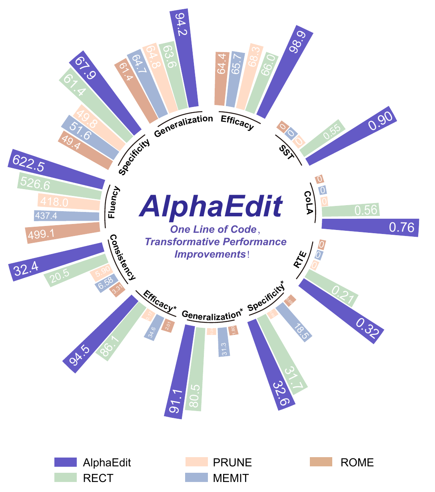

# Writing, figures, and talks

You have spent a lot of time with the problem; your readers have not. Your writing needs to give them enough context to understand **the question, your approach, and the evidence**.

## Say what you found

Write a few sentences: what was wrong before, what did you do, and what do we now know? Put the corresponding figures, experiments, or analyses beside them. Unsupported sentences reveal missing work.

For example:

<strong>Missing testable detail</strong>
We propose an innovative, efficient, robust framework.

<strong>Observation, change, and test</strong>
The system loses early constraints in long tasks. We add a task-state record and test whether it reduces these failures.

The second version identifies an observation, a method, and a test. Check that later results answer the opening statement.

## From structure to paragraphs

[Zhewei Huang and Xiaohan Ding's Writing AI Conference Papers](https://github.com/hzwer/WritingAIPaper) helps with contributions, structure, and revision. Pair it with [Simon Peyton Jones's writing talk](https://www.microsoft.com/en-us/research/academic-program/write-great-research-paper/) and think about helping readers grasp the key idea early.

- **Introduction:** establish the question, the gap in existing work, and the contribution.
- **Methods:** explain inputs, outputs, core steps, and necessary assumptions.
- **Experiments:** provide comparisons, ablations, and analyses corresponding to the claims.
- **Related work:** explain connections and differences from existing methods.

State important conditions directly and remove unsupported adjectives. For a disputed choice, explain reasons and results; you do not need a preemptive defense against every imaginable objection.

If you already have reading notes, group your judgments with supporting papers and experiments around the question you want to answer, then outline the paragraphs. When AI helps organize them, ask it to attach note locations and original sources to each paragraph, and add your own analysis. See [Note setup and example requests](irene-workflow.md#notes).

## Decide what a figure should show

- **Method figures:** show inputs → processing steps → outputs, with key modules and data flow.
- **Results figures:** identify comparisons, axes, units, evaluation conditions, and variation.
- **Legends and annotations:** give each color, arrow, and symbol a consistent meaning.

### Start with the overall system

When introducing a system, start with a concrete setting. This MineDojo overview separates the environment, the agent, and its knowledge sources. The examples show what the agent can do; the arrows show how the parts interact. For your own project, first identify <strong>the task, the component doing it, and its information sources.</strong>

<figure class="guide-figure">

<figcaption>Read the three regions first, then follow their connections. <a href="https://minedojo.org/" target="_blank" rel="noopener">MineDojo</a> · <a href="../../../public/blog/guide/figures/uestc/writing-minedojo-overview.png" target="_blank" rel="noopener">View full-size image</a></figcaption>
</figure>

### Align matching stages when comparing methods

To explain what changed, place both methods under the same column headings. Here, reading across follows each pipeline; reading down compares the same stage. Establish the shared stages first, then label the differences with text, symbols, and color so readers can find the corresponding parts.

<figure class="guide-figure">

<figcaption>Compare the two rows under each heading; open the full-size image to read the details. <a href="https://aclanthology.org/2026.findings-acl.1564/" target="_blank" rel="noopener">FunPoison · Figure 2</a> · <a href="../../../public/blog/guide/figures/uestc/writing-method-comparison.png" target="_blank" rel="noopener">View full-size image</a></figcaption>
</figure>

### Show task differences side by side

Names alone may not explain a dataset or its task groups. This LIBERO figure pairs each group with example scenes and a short description of what varies. For your own dataset, choose representative samples, use comparable views and sizes, and describe the differences beside them.

<figure class="guide-figure">

<figcaption>This crop keeps the task groups and their explanations together. <a href="https://libero-project.github.io/main.html" target="_blank" rel="noopener">LIBERO</a> · <a href="../../../public/blog/guide/figures/uestc/writing-libero-tasks.png" target="_blank" rel="noopener">View full-size image</a></figcaption>
</figure>

### Make the comparison easy to find

This figure separates code quality and comment quality into two panels while keeping method colors consistent. Readers can identify a method in the legend and compare it within each metric. Make <strong>methods, metrics, and units</strong> explicit in your own charts. This example also uses two vertical axes: check which axis belongs to each metric. Separate panels for different scales often make precise comparisons easier.

<figure class="guide-figure">

<figcaption>A layout example; evaluation conditions and metric definitions are given in the original Figure 1. <a href="https://aclanthology.org/2026.findings-acl.1564/" target="_blank" rel="noopener">FunPoison · Figure 1</a> · <a href="../../../public/blog/guide/figures/uestc/writing-grouped-results.png" target="_blank" rel="noopener">View full-size image</a></figcaption>
</figure>

### Make scales clear in a multi-metric overview

AlphaEdit arranges metric groups around a circle, giving readers an overview of the dimensions being compared. To read a result, return to its group label, value, and legend. <strong>Scales differ across groups, so bar lengths cannot be compared across them.</strong> If your main point is how much one metric improved, give that comparison its own chart.

<figure class="guide-figure guide-figure--compact">

<figcaption>The grouping and consistent colors are useful references; compare values within the same metric group. <a href="https://arxiv.org/abs/2410.02355" target="_blank" rel="noopener">AlphaEdit · Figure 2</a> · <a href="../../../public/blog/guide/figures/uestc/writing-radial-results.png" target="_blank" rel="noopener">View full-size image</a></figcaption>
</figure>

Inspect the figure at a smaller size and show it to someone outside the project. [Fundamentals of Data Visualization](https://clauswilke.com/dataviz/) helps with chart choice and communication. Use a whiteboard, slides, or another tool that serves the figure.

<aside class="guide-note"><strong>Before using the figure</strong>
At its final paper or slide size, the title, axes, and legend remain readable. The figure and caption identify the comparison and its conditions.
</aside>

## Typesetting and presenting

Use [Overleaf's LaTeX introduction](https://www.overleaf.com/learn/latex/Learn_LaTeX_in_30_minutes) for text, equations, figures, and citations. For everyday notes and READMEs, [basic Markdown](https://www.markdownguide.org/basic-syntax/) is enough to begin.

For a talk, consider what the audience knows and select enough material to explain the central question. See [the research-talk lecture](https://www.microsoft.com/en-us/research/academic-program/give-great-research-talk/). A lab update can center on the question, key results, current interpretation, and what you want to discuss.

[Experiment records](research.md#q43) · [AI-assisted revision](ai.md)

## Consult while drafting

[Huang and Ding's guide](blogs.md#ding) helps with contributions, structure, and drafts. [The Bottom Line](lesswrong.md#bottom-line) discusses how evidence determines conclusions. LaTeX, figures, and presentation resources are in the [research catalog](catalog-research.md#topic-11).
